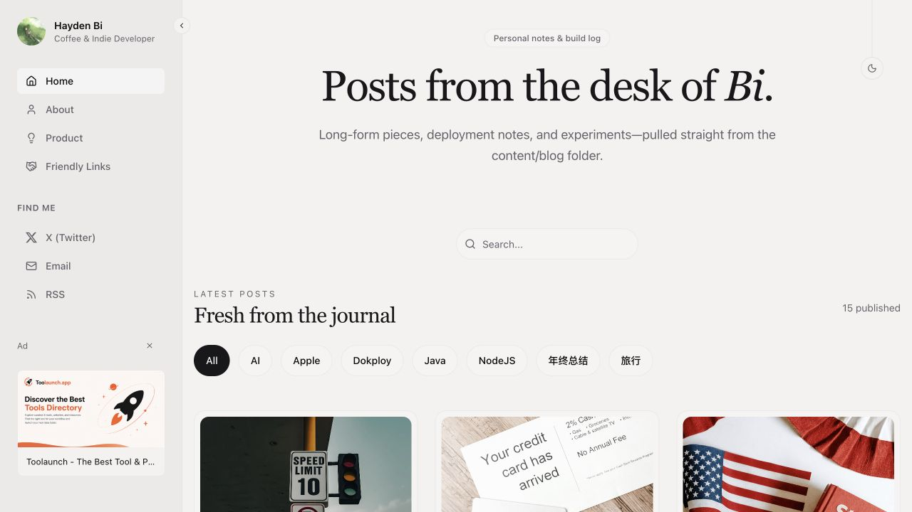
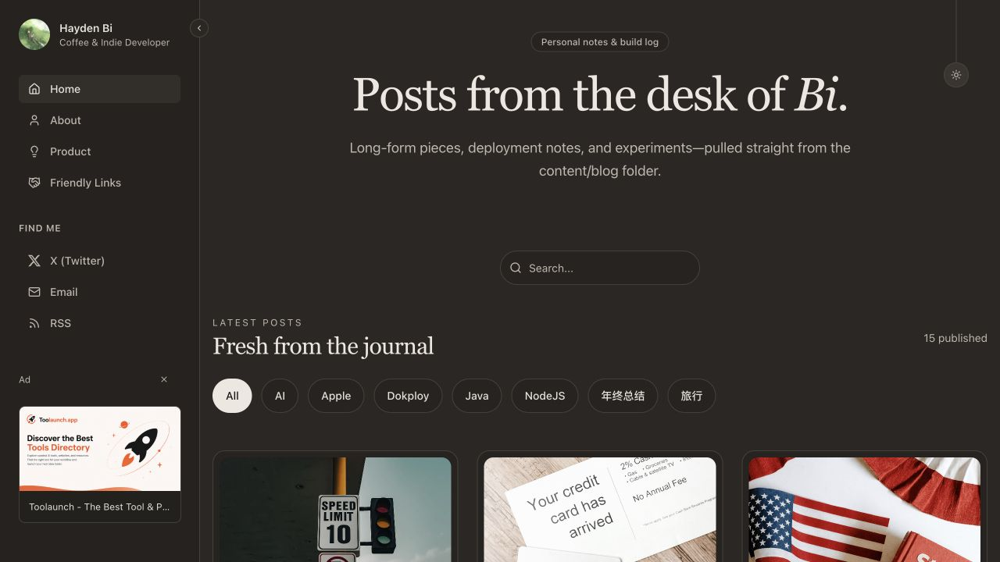
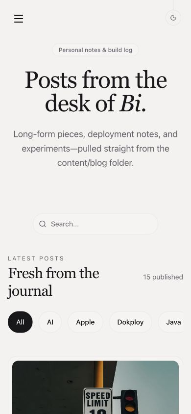
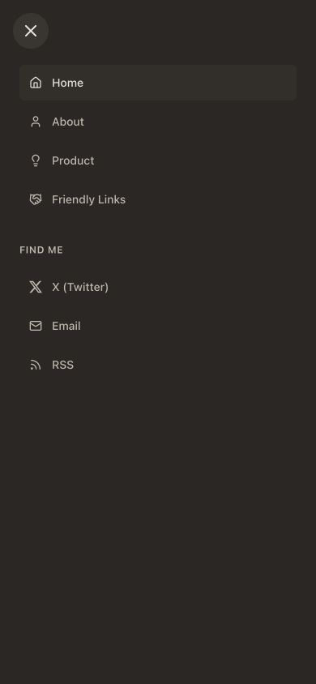
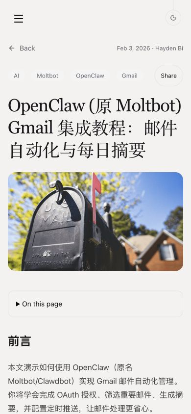
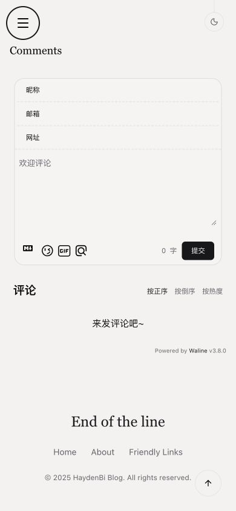
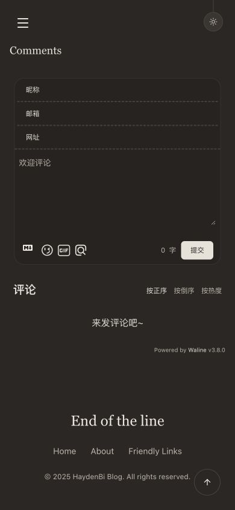

# 样式与文章维护一致性验收

2026-10-28 完成本地修改和验证，未部署。

## 改动

- 统一 surface、surface-border、surface-hover、image-placeholder 及文字 token；首页、关于、产品、友链、图注和 Waline 使用语义变量，Shiki 配色保留。
- 主题与折叠按钮保留原可见圆形和动画，实际点击区域扩大为 44×44px；移动菜单、分页、广告关闭、分享和复制控件同步调整。
- 移动菜单使用原生 dialog，支持 Escape、关闭后恢复焦点；切换到桌面宽度时关闭，焦点移到侧栏折叠按钮，解除滚动锁。
- 可选 updated 字段手动维护，校验真实日期且不能早于 date；同步文章展示、JSON-LD、Open Graph、sitemap 与 RSS 频道维护日期，保留发布排序和 pubDate。
- 首页与 API 共用服务端全文匹配，支持标题、摘要、描述、标签、分类和正文；现有 API 结构、空查询约定和九篇分页保持。
- 删除无引用的旧 Header、Footer、SiteHeader 和 MobileNavigation，BlogLayout 继续作为唯一布局。

## 自动化检查

| 检查 | 结果 |
| --- | --- |
| pnpm test:content | 5 项通过，包含日期合法性、中文/大小写/空白、各搜索字段与未发布排除 |
| pnpm test:watch | 1 项通过，包含更新时间在 HTML、JSON-LD、OG、sitemap、RSS 的实际输出，以及首页/API 搜索、分类、撤稿和删除 |
| pnpm test:migration | 8 项通过，包含旧文章、完整 SEO 基线、404、参数、搜索集合与分页一致性、发现端点和浏览器包隔离 |
| pnpm exec tsc --noEmit | 通过 |
| VITE_APP_URL=https://haydenbi.com pnpm build | 通过 |
| 修改的 21 个适用源文件 Biome | 通过；全局 CSS 已纳入检查 |
| pnpm check | 37 个既有错误、26 条警告、5 条提示；改动前为 38/26/5，删除旧 Header 后少一个格式错误 |
| git diff --check | 通过 |

历史文章、legacy-posts.json 和 legacy-seo.json 与修改前逐字相同；未补造 updated，未更改 slug、canonical、URL 行为或评论路径。测试创建的临时文章已删除。

## 浏览器检查

检查桌面 1280×720、1280×900 和手机 390×844。主题、折叠、广告关闭和分页按钮均实测为 44×44px；手机导航链接与复制按钮高度至少 44px。

快速连续折叠后状态正确，页面没有横向溢出；拉绳主题可切换，明暗模式样式正确；手机 Escape 关闭后焦点返回触发按钮，Enter 可重开，跨断点关闭后焦点落在可见桌面按钮，菜单内跳转后关闭并解除滚动锁。键盘焦点具有 2px 可见轮廓。图注采用主题文字色，Waline 明暗主题均已实际加载检查，没有发布测试评论。

浅色侧栏次要文字对比度为 5.03:1，页面/搜索占位文字为 5.40:1；暗色首页采样的次要文字最低 7.47:1，搜索占位文字为 7.86:1。

减少动画模式已代码复核：CSS 媒体查询覆盖过渡，侧栏和主题动画保留 matchMedia 守卫及偏好变更处理。当前浏览器工具不提供媒体偏好模拟，因此未进行该模式的浏览器实测。

开发环境 Waline 仍有原有 Vue feature flags 与 imageUploader=false 的警告；本次不调整评论功能配置。生产构建存在第三方 use client 指令的 bundler 提示，构建成功。

## 截图

