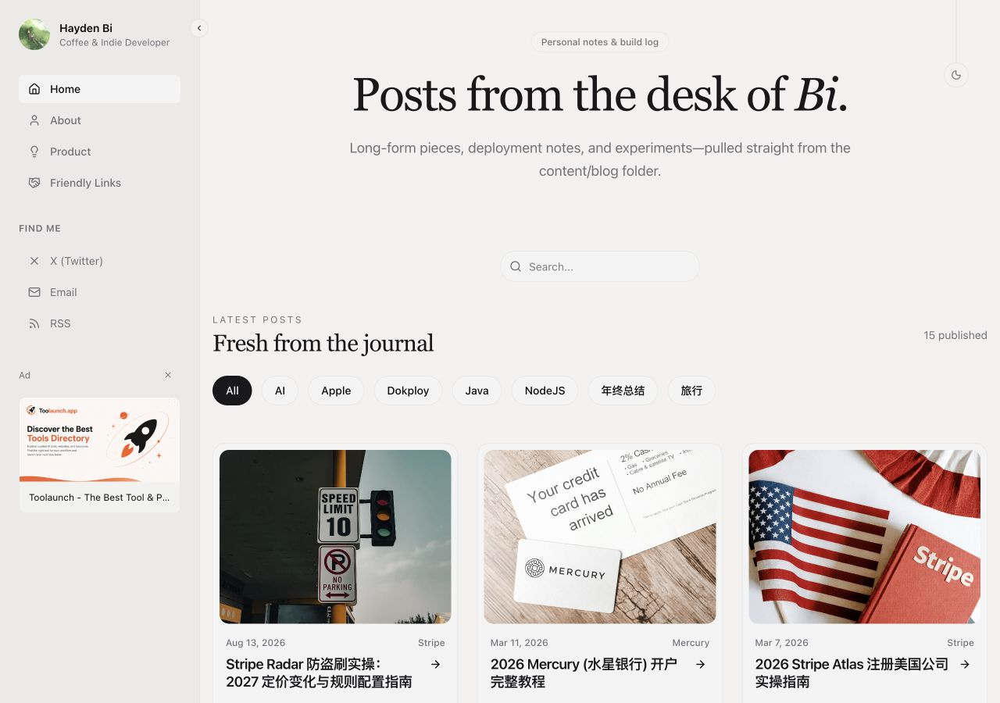
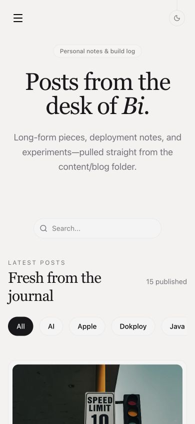
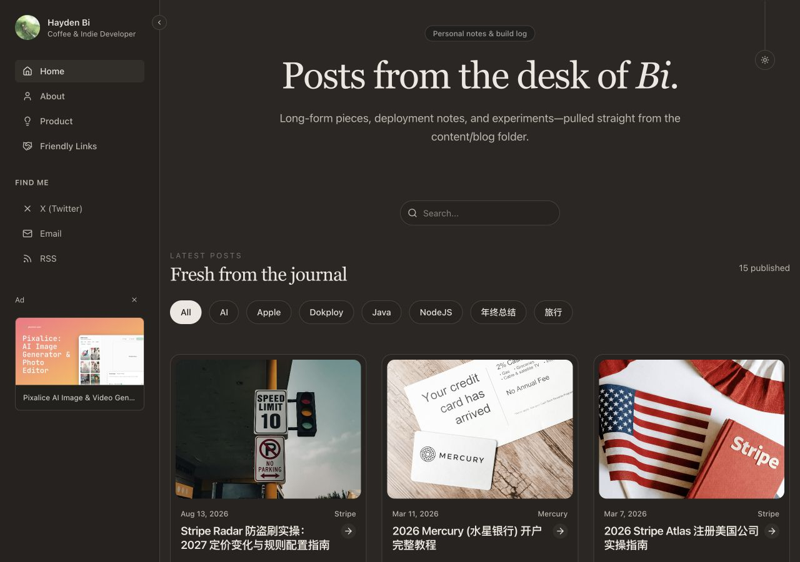
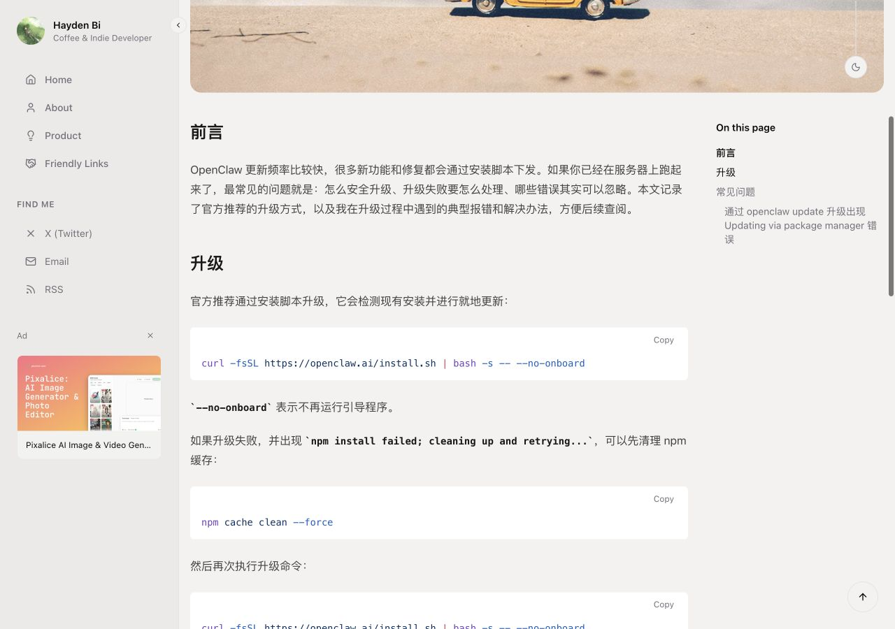
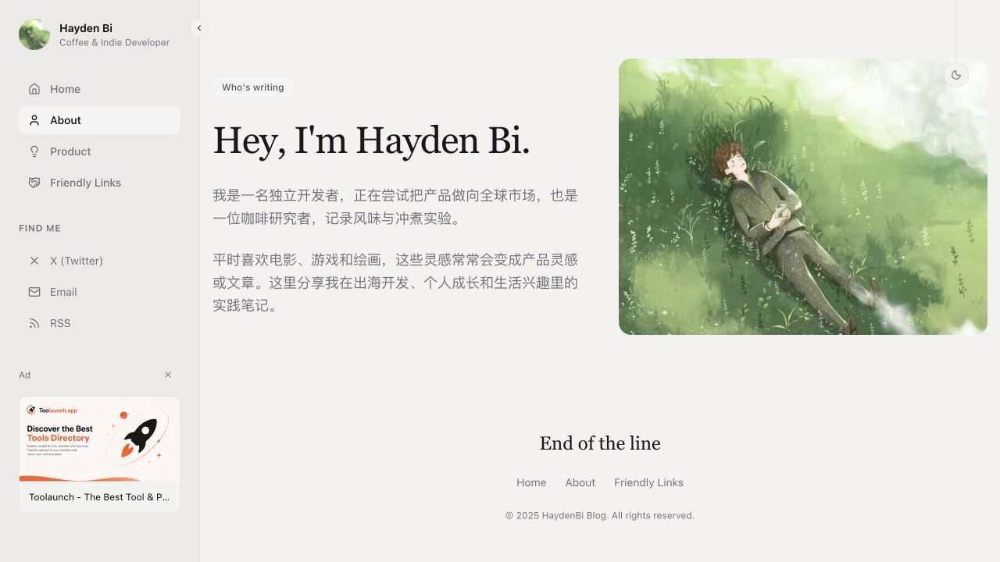
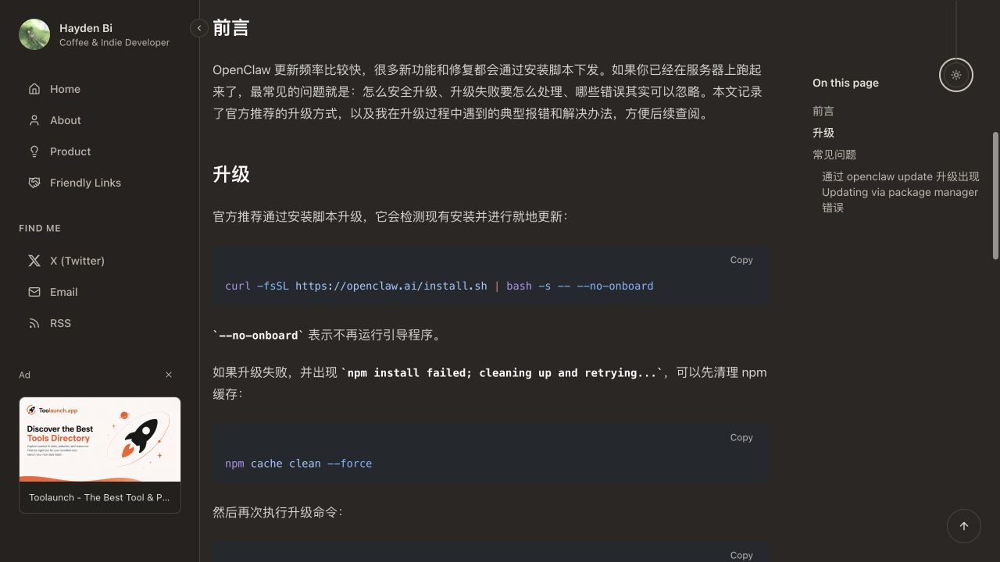
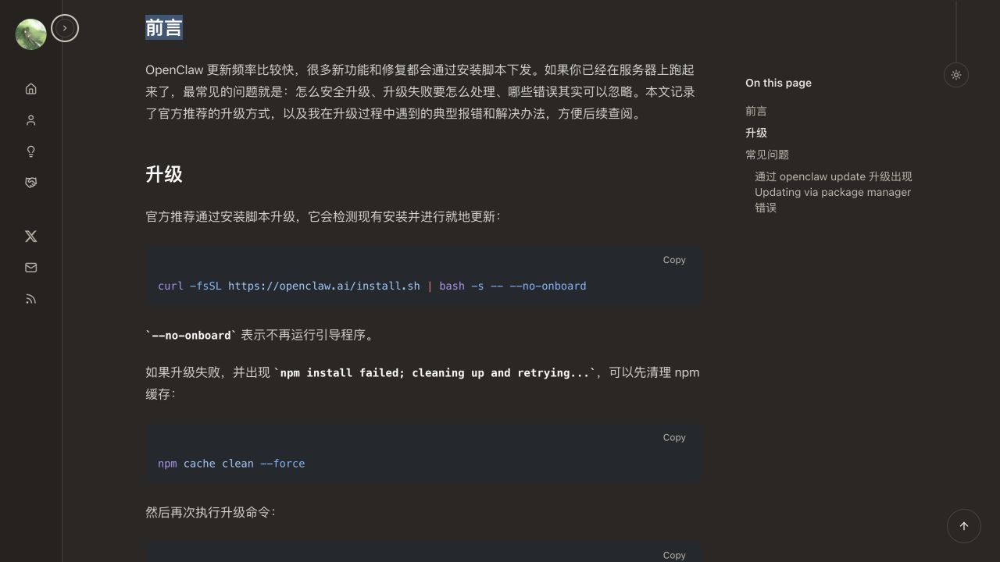
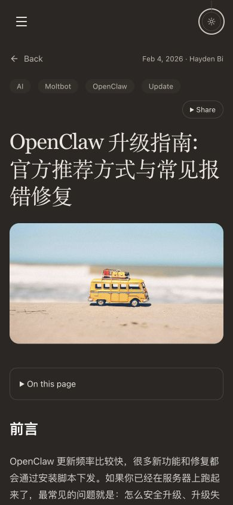

# 博客迁移验收

2026-10-28 完成代码迁移与本地验证，未部署生产。

## 内容与地址

- 15 篇文章、7 个分类均已迁入 Content Collections，保留标题、日期、摘要、标签、作者、封面以及大小写和含句点 slug。
- `/`、`/about`、`/friends`、`/product`、`/posts/{slug}` 均返回 200；`/blog` 展示文章列表并使用首页 canonical。
- 文章列表每页九篇，保留分类、搜索、分页及历史导航恢复。
- 无效文章、撤稿文章、模板政策页及未开放语言路径返回真实 404 和 noindex。
- sitemap 包含 19 个公开规范地址；RSS 包含 15 篇文章。API 搜索、llms.txt、Manifest、图标和原站验证文件均可访问。
- 旧构建中可读取的 10 篇文章目录已逐项比对一致；另外 5 篇的旧构建记录为图片尺寸获取失败，无法提取目录基线，使用相同 GitHub slug 规则生成并验证链接目标。

## 架构与兼容

Content Collections 在构建阶段调用 markdown-it 与 Shiki，生成 HTML、目录和搜索文本。正文经服务端函数提供给路由，浏览器包不包含全站正文或编译工具。生产产物从系统临时目录启动验收，运行不依赖内容源码或旧仓库。

Paraglide 与中英日翻译资源保留，当前仅发布无前缀中文页面，没有语言选择入口或其他语言 hreflang。

显式固定并统一 `@tanstack/router-core` 版本，解决 Nitro 与客户端使用不同状态编码造成的 hydration 问题。临时诊断代码已移除，生产首屏、分类与文章导航的浏览器控制台无 hydration 报错。

已将旧 Waline、共享图片和社交配置迁入被 Git 忽略的本地环境文件；评论沿用原始文章路径和 `/friends`。已实际加载评论界面，未发布测试评论。共享图片返回 HTTP 200。

## 目录与文案整理复核

页面统一采用 `src/routes/(marketing)/{页面}/index.tsx`，文章采用 `posts/$slug/index.tsx`；首页仍在根目录，搜索接口位于 `src/routes/api/search.ts`。路由树由 `pnpm generate-routes` 生成。

文章查询与服务端函数在 `modules/post`，modules 仅保留 post、search、friends、product 和 feed 业务模块。每个页面在自己的路由 `head` 中直接调用通用 `pageHead`；首页和博客的列表参数、loader 也直接定义在各自路由中，没有页面专属 SEO 文件或列表路由装配模块。robots、llms、Manifest、sitemap 的生成实现直接位于各自根路由文件，llms 和 sitemap 仍通过统一文章业务查询读取已发布内容。

友链与产品模块负责各自的数据筛选和排序，`SiteEntry` 共享类型位于 types，Analytics 服务端集成位于 integrations。相关空目录已删除。`lib` 保留通用 SEO 和 XML 等工具，已删除 `site-data.ts`；静态 SEO 和发现资源文案使用 Paraglide 消息，文章元数据使用 frontmatter。

恢复 29 个无关文件并验证其字节内容与 Git HEAD 完全相同，包括 R2/S3 适配器、工具函数和 UI primitive。用户已有的依赖与内容配置改动继续保留，仅对实际修改的文件执行格式化。

整理前保存 27 个生产响应，整理后使用手动禁用重定向的请求逐项比较：所有状态码、标题、meta、canonical、分享标签和 JSON-LD 完全相同，五个发现资源正文也逐字相同。22 个页面的 SEO 基线已存入 `scripts/fixtures/legacy-seo.json`，并加入现有迁移回归。

生产预览重新验证：首页与文章首屏、关于/产品/文章客户端跳转、390×844 移动菜单跳转与关闭、旧地址无尾斜杠；浏览器无 hydration 错误或其他警告。页面设计保持原样。

## 自动化结果

| 检查 | 结果 |
| --- | --- |
| `pnpm check` | 恢复无关文件后报告 38 个原有错误、26 条警告及 5 条提示；见 [基线明细](biome-baseline.md) |
| 实际变更文件 Biome 检查 | 通过，42 个适用源文件；不自动修复无关文件 |
| `pnpm exec tsc --noEmit` | 通过，包含新增 TypeScript 验收脚本 |
| `pnpm check:i18n` | 通过，75 条消息、中英日字段一致 |
| `pnpm test:content` | 2 项通过：中文与重复标题、表格、删除线、图片、代码高亮及未知语言 |
| `pnpm test:watch` | 1 项通过：新增、编辑、撤稿、删除后的 SSR 更新 |
| `VITE_APP_URL=https://haydenbi.com pnpm build` | 通过，已执行清理缓存与生成目录后的构建 |
| `pnpm test:migration` | 7 项通过：内容基线、SSR/SEO、404、查询、搜索、发现端点、浏览器包隔离 |
| `git diff --check` | 通过 |

## 界面检查

检查了桌面 1280×900 与手机 390×844：侧栏与移动导航、明暗主题及刷新恢复、筛选搜索及后退恢复、目录跳转、代码复制、分享菜单及 Escape 关闭、广告显示偏好和评论加载。手机文章的页面宽度与滚动宽度均为 390，无横向溢出。文章分享按钮已避开固定主题按钮。

### 桌面首页

### 手机首页

### 暗色主题

### 文章与代码高亮

### 整理后桌面与手机复核

## 侧栏、目录与交互动画复核

- Find Me 的三个链接与主导航复用相同样式：14px、500 字重、20px 行高，内边距 8px/12px，悬停反馈一致；桌面和手机菜单均已检查。
- X 品牌图标使用旧项目相同的 SVG 路径，关闭图标不变。
- 桌面目录增加 16px 左内边距，正文网格宽度与手机目录保持不变。
- 侧栏采用约 300ms 的背景位移和 FLIP 内容位移，文字淡入淡出，无文字缩放。已验证鼠标操作、键盘快速反向操作及收缩/展开后的布局，无横向溢出。
- 主题拉绳下移 20px，120ms 后切换主题，再用 180ms 返回；绳子顶部保持固定。双击防重入、Enter/Space、主题刷新恢复均已验证，动画不用于首屏恢复和跨标签同步。
- 减少动态效果分支会跳过位移动画，偏好变化会结束正在播放的动画；代码分支及卸载清理已检查。Chrome 仿真实测被手动操作中断，未完成该模式的浏览器实测，未更改系统偏好。
- 本轮变更文件 Biome、TypeScript、75 条消息检查、生产构建与 7 项迁移回归全部通过。生产预览无新增浏览器警告或 hydration 错误；开发模式下 Waline 原有 Vue 提示未纳入本次修改。全量 Biome 仍为既有 38 个错误、26 条警告、5 条提示。

## 上线配置

生产域名沿用 `https://haydenbi.com`。本地 `.env` 保留开发地址；生产构建显式设置 `VITE_APP_URL`，Docker 构建参数默认使用原域名。部署配置说明见仓库 README。旧 Next.js 仓库保留在本机作为参考，并从版本控制、类型检查、lint 和 Docker 构建中排除。
