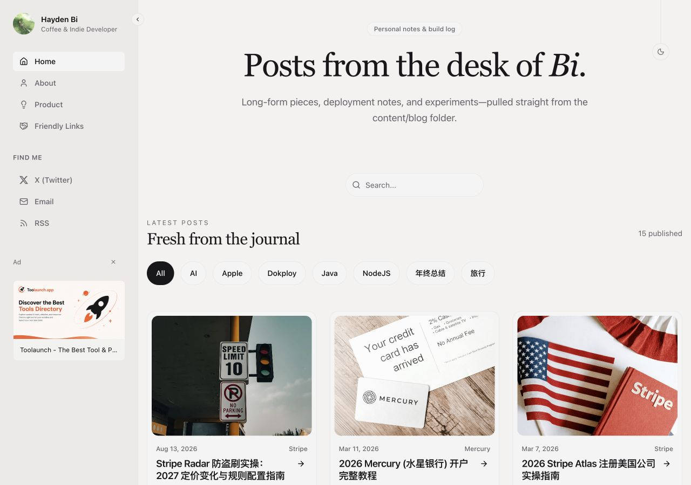
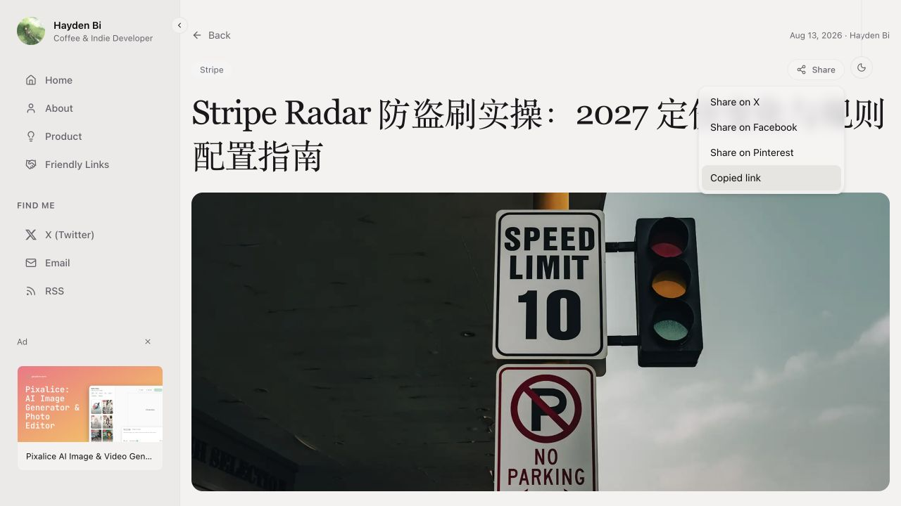
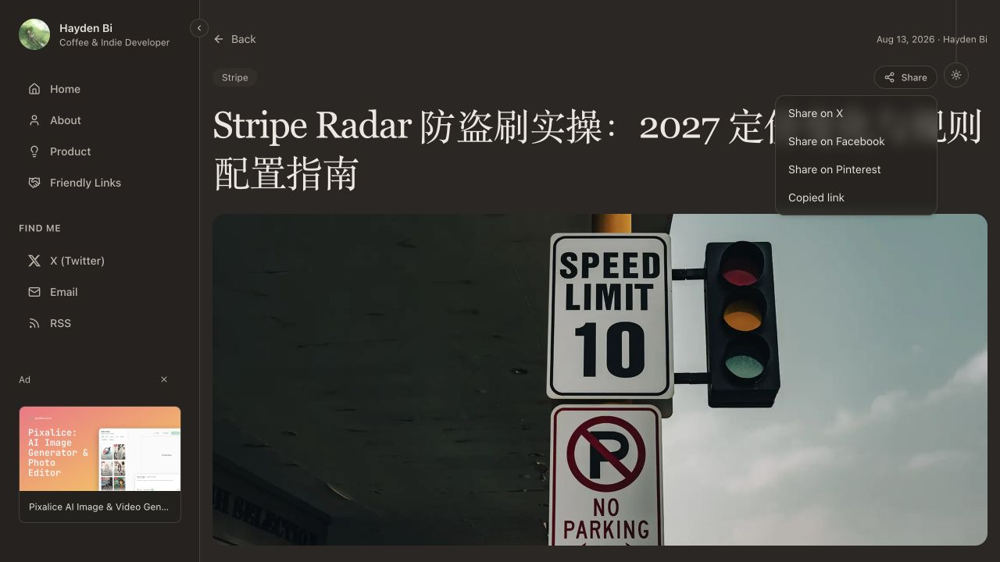
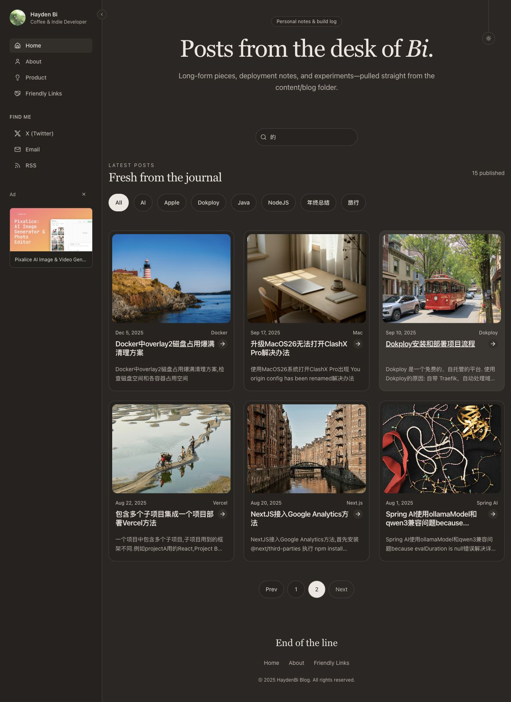
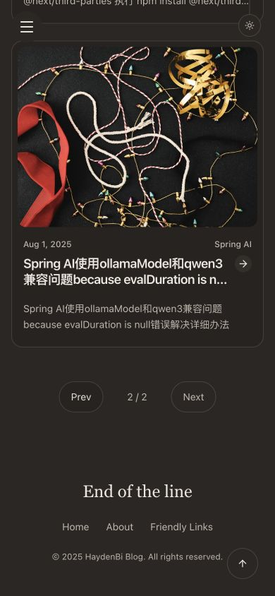

# 模块、布局与首页重构验收

2026-10-28 完成本地实现与验收，未部署。

## 结构与行为

- modules 中每个业务模块统一使用 service.ts；post 合并查询匹配、文章读取与 createServerFn 调用封装，types.ts 提供 PostListData 等展示类型。Content Collections 读取由 createServerOnlyFn 隔离。
- API 搜索继续由 routes/api/search.ts 调用 search/service.ts；没有增加文章 HTTP API。
- BlogLayout 保留折叠状态、侧栏/正文测量与联动动画，独立提取 BlogSidebar、Navigation/SocialLinks、MobileNavigation、SidebarAd、BlogFooter 与 BackToTop。菜单数据集中在 src/config/navigation.ts。
- HomePage 组合 HomeHero 与 PostList，根路由和 /blog 共用；main 及主内容锚点由布局唯一维护。
- ShareMenu 恢复旧博客 Share2 图标、30px 高紧凑胶囊、原菜单间距/圆角/阴影/模糊效果，使用主题 token。保留外部点击、Escape、三种社交分享、Copy Link/Copied link 两秒反馈与 Clipboard API 不可用时的 textarea 回退；复制失败不显示成功，清理事件与定时器。
- 友链仍使用通用 CopyButton，因此该组件保留。
- PostPagination 提供 Prev/Next，首尾禁用；大屏最多七个页码或省略号项目，1024px 以下使用当前页/总页数。页码生成数量与总页数无关，翻页保留 q/category，第一页省略 page。

## 自动化验证

| 检查 | 结果 |
| --- | --- |
| pnpm test:content | 11 项通过：Markdown、更新时间、共享搜索、分页范围/查询保留、正常复制/权限失败/兼容回退及清理 |
| pnpm test:migration | 9 项通过：原文章与完整 SEO 基线、404、查询、唯一 main、方向分页、首页/API 搜索一致性、发现端点与浏览器包隔离 |
| pnpm test:watch | 1 项通过：文章新增、编辑、updated 输出、搜索、撤稿及删除 |
| pnpm exec tsc --noEmit | 通过 |
| VITE_APP_URL=https://haydenbi.com pnpm build | 通过 |
| 37 个本次修改/新增的适用源文件 Biome | 通过 |
| 全量 pnpm check | 保持原有 37 个错误、26 条警告、5 条提示，无新增 |
| git diff --check | 通过 |

文章原文、元数据、legacy-posts.json、legacy-seo.json 与生成路由树逐字保持；临时测试文章已删除。生产包未包含文章正文全集及 Markdown/Shiki 编译工具。

## 浏览器验证

桌面 1280×900、手机 390×844 已检查。开发环境确认紧凑 Share 图标与菜单、三种分享 URL 参数、Copied link 反馈、Escape 和外部点击关闭；复制兼容回退与失败处理通过原生 Node 测试验证，未修改浏览器 API 进行模拟。

搜索“的”后 Next 保留 q，Previous 返回第一页不带 page；浏览器后退/前进恢复查询与页码。大页数算法验证到十亿页，最多七个项目；手机显示 Prev、2 / 2、禁用的 Next，没有横向溢出。桌面快速连续六次折叠后状态和布局正确。手机菜单 Escape 恢复触发器焦点、Enter 重开，切换桌面后关闭、解除滚动锁，并把焦点移到可见侧栏按钮。

另启动最终生产构建，实际完成首页 → 第二页 → Docker 文章的客户端跳转：第二页六篇文章，文章正文与代码块完整，canonical 为正式域名，浏览器 error 日志为空。既有 Waline/Vue 开发警告与第三方构建提示未在本轮调整。减少动画守卫随原动画代码保留，当前浏览器工具不支持媒体偏好模拟，未额外做该模式的浏览器实测。

## 截图

