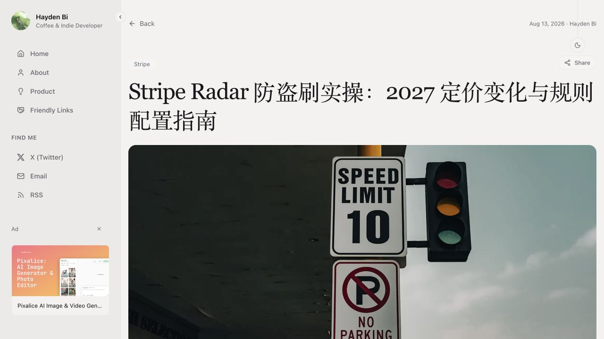
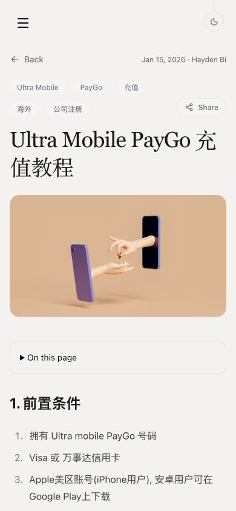
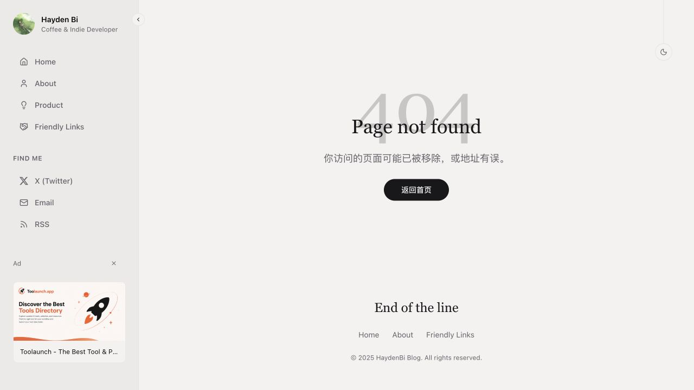
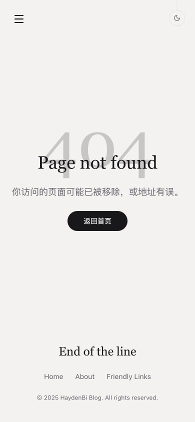
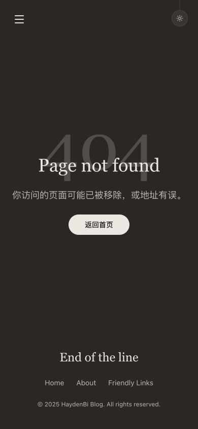

# 空列表、Share 与 404 样式复核

2026-10-28。

- 无文章时提示“暂时还没有文章，欢迎过段时间再来看看。”；搜索或分类无结果时提示“没有找到相关文章，试试其他关键词或分类吧。”。提示不包含文件格式或目录说明。
- Share 贴齐文章内容右边缘，标签独立换行；桌面保留纵向空间避开固定主题按钮。实测桌面右边缘均为 1264px、手机均为 374px，没有横向溢出或主题按钮重叠。
- 404 按旧 Next.js 页恢复：128px 浅色衬线 404，36px 衬线 Page not found，相对上移 48px 的内容组与圆角返回按钮。保留现有中文说明与返回文案，保留真实 404、noindex 和 SEO 标签。

修改文件 Biome、类型检查、生产构建与现有 9 项迁移回归均通过，SEO 基线保持。已检查桌面 1280×720、手机 390×844，以及 404 的明暗主题。

